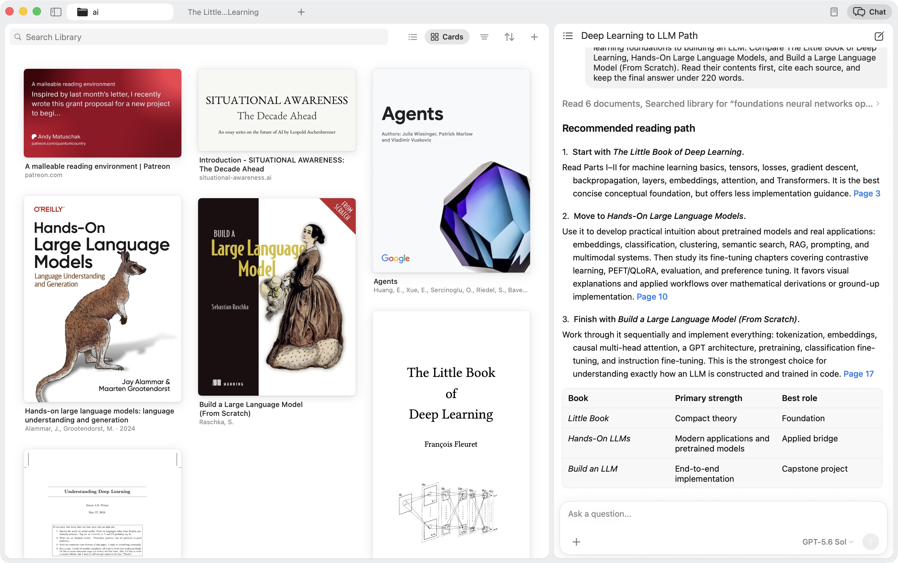
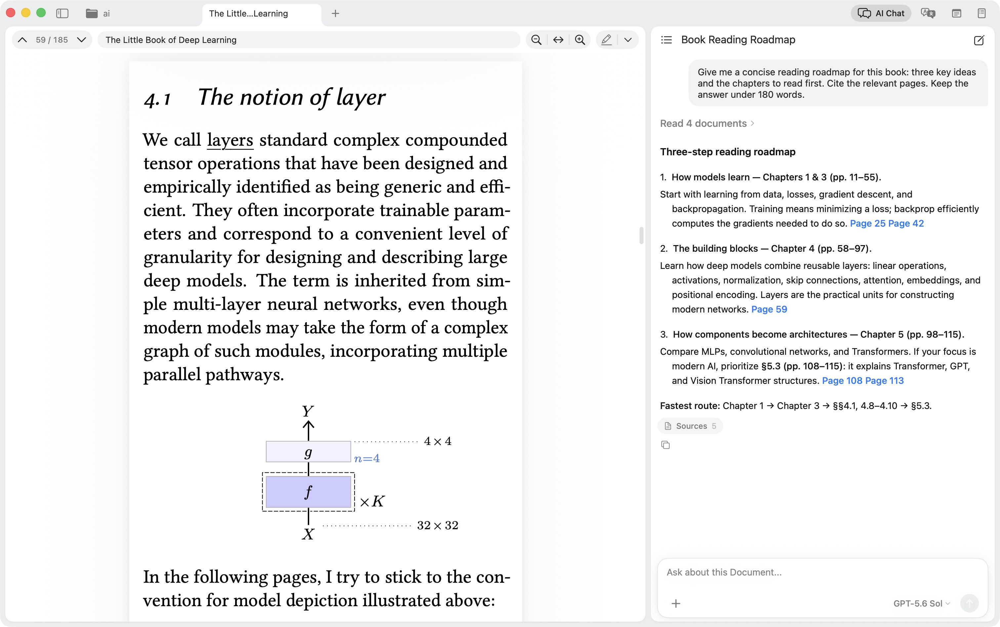
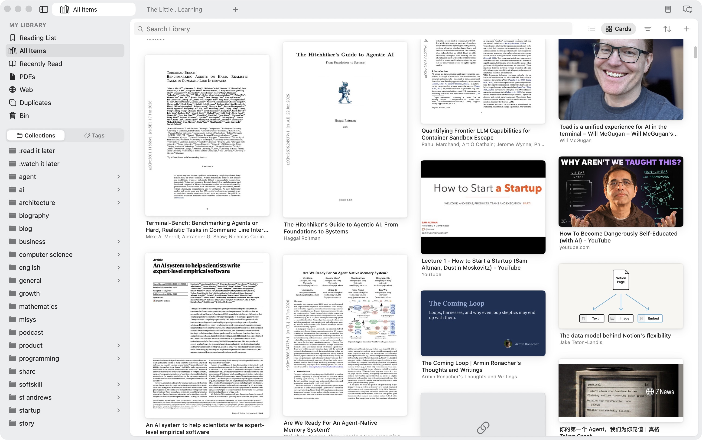
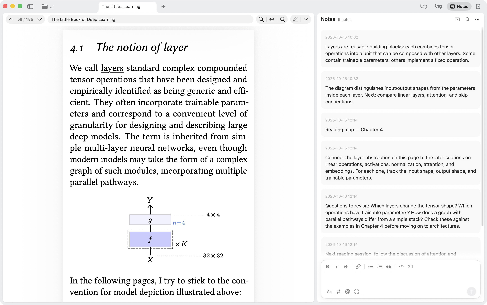
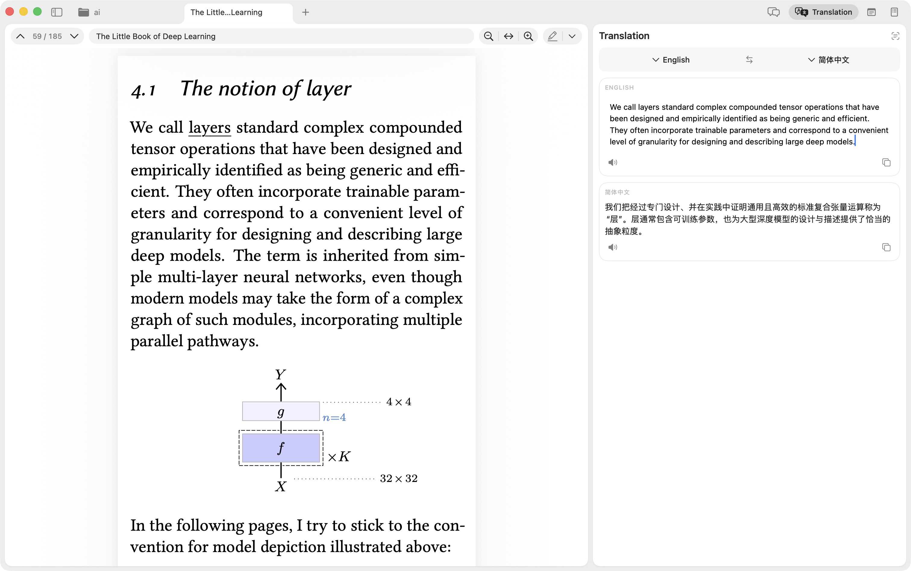
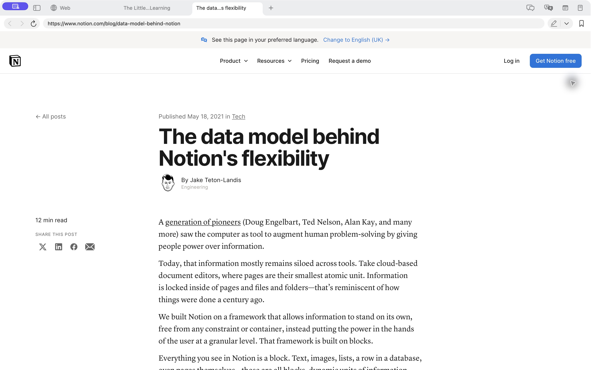

<div align="center">

# OakReader

**A native macOS reader and AI knowledge base, shared by you and your agent.**

Organize PDFs, papers, books, and saved web pages. Read, annotate, translate,
and ask questions beside your sources, with clickable page citations.

[Download](https://github.com/oakreader/oakreader/releases/latest) · [Website](https://oakreader.com) · [Report an issue](https://github.com/oakreader/oakreader/issues) · [简体中文](README.zh-CN.md)


[](LICENSE)



<sub>Captured from the macOS development build, October 2026, with example research conversations and reading notes.</sub>

</div>

## Get started

Requires **macOS 15.4 or later**.

1. [Download the latest release](https://github.com/oakreader/oakreader/releases/latest), open the disk image, and drag OakReader to Applications.
2. Import a document into your library and open it to start reading and taking notes.
3. To use AI, configure a provider and model in **Settings → LLM**, then open the chat or translation panel beside your document.

The release includes the backend and CLI. Developer tools are only needed when building from source.

## Core features

<table>
  <tr>
    <td width="60%" valign="middle">
      
    </td>
    <td width="40%" valign="middle">
      <b>Research across your sources</b><br/>
      Ask a question across your library or a focused collection. Let AI find and read relevant sources, compare documents, and link its answers back to the originals. Shown here: a learning path built from three books.
    </td>
  </tr>
  <tr>
    <td width="60%" valign="middle">
      
    </td>
    <td width="40%" valign="middle">
      <b>Understand a document, check the source</b><br/>
      Ask for an explanation, summary, or reading plan beside your document. Follow page citations back to the source, or attach a selection or screenshot for more context.
    </td>
  </tr>
  <tr>
    <td width="60%" valign="middle">
      
    </td>
    <td width="40%" valign="middle">
      <b>Everything you read, one place</b><br/>
      Browse PDFs, books, and saved web pages as cards or a list. Organize them with collections, tags, a reading list, and library search.
    </td>
  </tr>
  <tr>
    <td width="60%" valign="middle">
      
    </td>
    <td width="40%" valign="middle">
      <b>Turn reading into lasting notes</b><br/>
      Collect highlights, thoughts, and screenshot clips beside the source. Format notes, add tags, link to other notes, and export to Markdown.
    </td>
  </tr>
  <tr>
    <td width="60%" valign="middle">
      
    </td>
    <td width="40%" valign="middle">
      <b>Translate beside the original</b><br/>
      Read source text and its translation in a dedicated panel. Select a passage or capture a region with OCR, switch languages, and listen to the text.
    </td>
  </tr>
  <tr>
    <td width="60%" valign="middle">
      
    </td>
    <td width="40%" valign="middle">
      <b>The web, built in</b><br/>
      Search, open links, and read live pages signed in — then save what matters into your library.
    </td>
  </tr>
</table>

**Choose your model** — connect a supported cloud provider or a local server with a compatible API in Settings → LLM.

### Give your agent access to the same library

The `oak` CLI lets external agents search your catalog, read documents, retrieve notes, and manage collections. The sources and notes you organize remain available for follow-up research. Quick Chat and reusable skills bring reading assistance beyond the document window.

Reference management also includes editable authors, publication details, cite keys, and citation copying.

## Help and feedback

For bugs and feature requests, [open a GitHub issue](https://github.com/oakreader/oakreader/issues). For a bug, include your OakReader version, macOS version, and steps to reproduce it. Screenshots or a sample document help when relevant.

## Tech stack

| Component | Framework |
|-----------|-----------|
| UI | SwiftUI + AppKit |
| PDF engine | PDFKit |
| Catalog | SQLite via the shared TypeScript/Bun backend |
| AI | Multi-provider agent runtime via `pi-ai` / `pi-agent-core`, bundled as a local sidecar |
| Search & agent access | Library filtering and the `oak` CLI for catalog search, document text, and notes |
| Web capture | Browser extension (WXT) → local snapshot server |
| OCR | Apple Vision |

## Build from source

### Prerequisites

- macOS 15.4 or later
- Xcode 16 or later, including its command-line tools
- Bun and pnpm 10 (to install dependencies and build the bundled backend and CLI)
- XcodeGen (`brew install xcodegen` with Homebrew)

### Set up

```bash
git clone https://github.com/oakreader/oakreader.git
cd oakreader
pnpm install --frozen-lockfile
xcodegen generate
```

### Code signing (one-time, for your own build)

The committed project signs with the maintainer's Apple team, which you can't
use. Point it at your own identity with a local, git-ignored override — you
don't edit any tracked file:

```bash
scripts/setup-signing.sh
```

It asks for your Apple Developer **Team ID** (find it at
developer.apple.com → Account → Membership; a free Apple ID works) and writes
`xcconfig/DeveloperSettings.xcconfig`. No Apple account? Press Enter to build
**ad-hoc** instead — fine for local development. (You can also copy
`xcconfig/DeveloperSettings.example.xcconfig` by hand.)

Debug builds drop the restricted `keychain-access-groups` entitlement so any
team — or ad-hoc — can build. Configure AI credentials in **Settings → LLM**,
or supply a provider environment variable such as `OPENAI_API_KEY`.

### Run

```bash
open OakReader.xcodeproj
```

Select the **OakReader** scheme, then build and run (<kbd>Cmd</kbd>+<kbd>R</kbd>).
`project.yml` is the source of truth — the `.xcodeproj` is generated by XcodeGen.

## Contributing

Bug reports, fixes, and focused improvements are welcome. Follow the build instructions above to run the app locally. For substantial changes, [open an issue](https://github.com/oakreader/oakreader/issues) to discuss the approach before sending a large PR.

## License

[MIT](LICENSE) © 2026 Jiwei Yuan
